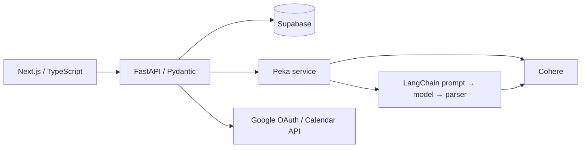

# Clash of Plans

### Less juggling. More headspace.

A student productivity workspace that brings task management, visual scheduling, and an AI assistant into one flow. Built collaboratively for **GenAI Genesis 2025**.

[Project story on Devpost](https://devpost.com/software/clash-of-plans) · [Architecture & AI explained](docs/architecture.md) · [Research behind the design](docs/research.md)

## Why we built it

Student life comes with competing priorities: assignments, lectures, work, and time for yourself. A to-do list tells you what needs doing. A calendar tells you when you're busy. Keeping both up to date—and remembering everything between them—becomes work of its own.

Clash of Plans connects those pieces. Capture a task, give it a priority and duration, place it in your day, and focus on one next step. Peka, the AI assistant, helps translate everyday language into structured tasks and offers task recommendations.

Our purpose is to make planning feel lighter, so students can spend less energy juggling tools and more time doing meaningful work and living outside it.

## A quick tour

| Experience | What to look for |
| --- | --- |
| Tasks | Create, edit, and delete tasks with priorities and duration estimates. Authenticated task records are stored in Supabase. |
| Visual planning | Drag tasks into the dashboard calendar and move events between time slots. Dashboard calendar state is local to the component; this is distinct from the Google Calendar integration. |
| Peka | Natural-language task creation, general productivity questions, and a separate task-analysis endpoint. |
| Focus | Configurable Pomodoro, short-break, and long-break timers. |
| Google Calendar | OAuth and calendar API integration code for listing, creating, updating, and deleting events. Requires Google configuration. |

## Research behind the idea

- **76.4%** of respondents in ACHA's Spring 2024 reference group reported moderate or high stress over the preceding 30 days. This describes the surveyed group, not every student. [ACHA](https://www.acha.org/ncha/)
- A meta-analysis of **158 studies**, covering **53,957 participants**, found moderate relationships between time management, academic achievement, and wellbeing. [Aeon, Faber & Panaccio, 2021](https://doi.org/10.1371/journal.pone.0245066)
- Experiments found that making specific plans reduced cognitive interference from unfinished goals during unrelated tasks. This supports our emphasis on concrete next steps. [Masicampo & Baumeister, 2011](https://pubmed.ncbi.nlm.nih.gov/21688924/)

These studies motivate the design. They do **not** establish that Clash of Plans improves mental health, grades, or productivity. We have not run an outcome study. See [research notes and limitations](docs/research.md).

## How it works



| Layer | Technologies | Responsibility |
| --- | --- | --- |
| Client | Next.js 14, React 18, TypeScript, Tailwind CSS, Framer Motion | Pages, task and calendar interactions, focus timer, assistant interface |
| API | Python, FastAPI, Pydantic | Authentication, validation, task routes, AI orchestration, Google integration |
| Persistence | Supabase | User, task, and onboarding-preference data |
| AI | Cohere, LangChain | Intent classification, task extraction, recommendations, typed response parsing |
| Development | Docker Compose | Client and API development services |

### Is this RAG? Does it use MCP?

The current implementation uses prompt-based generation and supplied task context. There is **no implemented retrieval pipeline or MCP server**. LangChain alone does not make an application RAG, and a direct Google API integration is not MCP.

The [architecture guide](docs/architecture.md) explains these distinctions, traces the implemented request flows, and describes what a future RAG or MCP extension would require.

## Run the frontend

Requires Node.js 20 or newer and npm. The public landing page can run without backend credentials; authenticated features require the backend setup below.

```sh
git clone https://github.com/JeffreyYeet1/cop.git
cd cop/client
npm ci
npm run dev
```

Open [localhost:3000](http://localhost:3000).

## Run the backend-connected app

The full app also requires Python 3.11+, a configured Supabase project, and a Cohere account. Google OAuth/Calendar needs its own credentials and consent configuration.

1. Create `server/.env` with your own `SUPABASE_URL`, `SUPABASE_API_KEY`, `COHERE_API_KEY`, `SECRET_KEY`, and `SESSION_SECRET_KEY`. Use separate random signing/session secrets. For Google features, also set `GOOGLE_CLIENT_ID` and `GOOGLE_CLIENT_SECRET` on the server, and `NEXT_PUBLIC_GOOGLE_CLIENT_ID` in `client/.env.local`. Keep private keys out of client variables and version control.
2. Provision the database tables expected by the code: `users`, `todo`, and `user_preferences`. This hackathon repository does not yet include a complete database migration or policy setup; environment variables alone are not sufficient to provision the full app. The models and repositories under `server/` document the expected fields.
3. Start the API in a separate terminal:

   ```sh
   cd server
   python3 -m venv venv
   source venv/bin/activate
   pip install -r requirements.txt
   uvicorn main:app --reload --port 8000
   ```

4. Start the client as above. API documentation is at [localhost:8000/docs](http://localhost:8000/docs).

Alternatively, with Docker and Compose installed and `server/.env` configured:

```sh
docker compose up --build
```

The client listens on port 3000 and the API on port 8000. Many app requests target `localhost:8000` directly; deployment to another host requires an API URL configuration pass.

The AI code was written against the pinned 2025 Cohere/LangChain packages and legacy `generate` / `command` interfaces. Availability and compatibility must be checked with a current provider account before presenting a live AI demo.

## Project map

```text
client/app/page.tsx                 Public landing page
client/app/DashComponents/          Task cards, dashboard calendar, focus timer
client/app/components/             Authentication UI and Peka command palette
server/api/routes/                 FastAPI endpoints
server/services/peka_service.py     Cohere calls and LangChain chains
server/repositories/               Supabase data access
server/schemas/                    Pydantic request/response models
docs/                              Architecture, research, limitations, roadmap
```

## Engineering decisions and next steps

This is a hackathon prototype. The clearest next steps are:

- Add reproducible database migrations and a consistent environment-based API URL.
- Complete the unified assistant's task-analysis context lookup; it currently calls an unimplemented `get_user_tasks()` method. The separate `/api/peka/analyze` route accepts task context explicitly.
- Migrate legacy model calls and add evaluation cases for extraction accuracy, invalid outputs, and cross-user access boundaries.
- Persist dashboard calendar state and connect it deliberately to the Google Calendar flow.
- Finish focus-session history: the current Next.js session route does not implement the GET endpoint the history component expects.
- Review authentication, CORS, cookies, and debug logging before public deployment.
- Evaluate whether retrieval or an MCP adapter solves an actual user need before adding either.

See [the architecture guide](docs/architecture.md) for details and a proposed implementation sequence. No production-readiness, adoption, or performance metrics are claimed.

## Team

Created by Jeffrey Ye, Truman (`tmanzhe`), and Terence Yang, as listed on [Devpost](https://devpost.com/software/clash-of-plans). This is a collaborative project; Git history records individual contributions.
