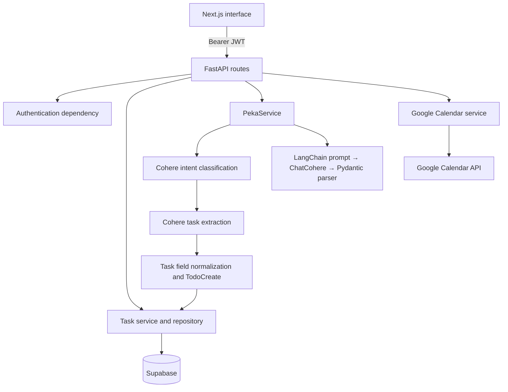

# Architecture and AI, explained

Clash of Plans is a student planning prototype built for GenAI Genesis 2025. Its engineering story is the connection between a typed React interface, authenticated API endpoints, database-backed tasks, and language-model assistance.

## The implemented system



The dashboard calendar is a separate frontend interaction using component state. The Google Calendar page and backend service demonstrate direct integration; automatic bidirectional synchronization between the two is not implemented.

### Task creation through Peka

1. The command palette sends a query and bearer token to `POST /api/peka/query`.
2. `get_current_user` authenticates the caller.
3. `PekaService` uses Cohere to classify intent. For task requests, another generation call extracts a title, description, priority, and estimated duration.
4. The service parses JSON, normalizes priority, and clamps duration to 1–1,440 minutes. This is application parsing, not a provider-enforced structured-output guarantee.
5. The route creates a `TodoCreate` model and writes the record through the task service under the authenticated user's ID.
6. The frontend dispatches a task-update event so the interface can refresh.

The constructor also makes a connection-test generation request. A single query can therefore involve several model calls. The source comments that describe a single call do not reflect the full path.

### Recommendations through LangChain

`POST /api/peka/analyze` accepts a list of task objects. The service serializes those tasks into the prompt, asking the model to consider priority, duration, task age, and progress.

The chain in `server/services/peka_service.py` is:

```text
ChatPromptTemplate → ChatCohere → PydanticOutputParser(PekaResponse)
```

Its expected output includes ordered task IDs, a top recommendation with a reason, and an explanation. General productivity questions use a similar chain with a different response model.

The separate analysis route is implemented, but it accepts client-supplied task context and does not independently verify ownership of every supplied task. The unified query's analyze branch calls a missing `get_user_tasks()` method and falls back to an error message. These are next steps, not completed capabilities.

## RAG: retrieving evidence before generating an answer

**Retrieval-augmented generation (RAG)** gives a model relevant information found at request time, then asks it to answer using that context. Retrieval can use keyword, SQL, semantic, or hybrid search; a vector database is one option, not a requirement. See [LangChain's explanation of retrieval](https://www.langchain.com/blog/retrieval).

The current app supplies task objects directly in a prompt. It does not implement query-driven retrieval, document ingestion, embeddings, or a searchable knowledge index. Supabase persistence and LangChain imports alone do not establish RAG. Although the original Devpost narrative mentions RAG, this checkout does not contain a retrieval pipeline.

### A useful future extension

Imagine asking: “What should I work on before my algorithms exam?” A RAG extension could:

1. Retrieve only the current user's relevant tasks, lecture notes, and deadlines.
2. Rank the retrieved context and fit it within the model's context budget.
3. Ask the model for a suggested plan with references to the retrieved items.
4. Validate cited IDs and ownership before returning the answer.
5. Evaluate retrieval relevance and whether recommendations are supported by the retrieved evidence.

A first iteration could use filtered SQL or keyword retrieval. Add embeddings only if semantic search improves a measured use case. Keep indexed records scoped to their owner, propagate edits and deletions, and treat retrieved text as untrusted data.

This is a proposed design. No RAG endpoint is shipped here.

## MCP: a common interface for AI tools

**Model Context Protocol (MCP)** standardizes how AI applications discover and use external tools and context. An MCP server can expose tools, resources, and prompts to compatible clients. See the [official server overview](https://modelcontextprotocol.io/specification/draft/server/index).

The current application uses regular HTTP endpoints, Cohere SDK calls, and Google's API. It contains no MCP server, client, tool registry, or protocol transport.

A future MCP adapter could wrap existing services with deliberately small operations:

| Proposed tool | Responsibility | Boundary |
| --- | --- | --- |
| `list_tasks` | Read the caller's task records | Enforce user identity and scoped access |
| `create_task` | Create a validated task | Require explicit user intent; reject invalid fields |
| `list_calendar_events` | Read an authorized calendar | Use the caller's Google permissions |
| `propose_time_block` | Return a suggested interval | Preview first; do not silently create an event |

The adapter would reuse service-layer business logic. It would need per-client authentication, permission checks, tool schemas, auditability, and deliberate confirmation for writes. Wrapping a REST route does not by itself supply those boundaries.

### How the concepts relate

| Concept | What it contributes | Status here |
| --- | --- | --- |
| Cohere | Model inference | Implemented through legacy SDK interfaces |
| LangChain | Prompt/model/parser composition | Implemented for analysis and general replies |
| Prompt context | Task data supplied to the model | Implemented in the explicit analysis endpoint |
| RAG | Query-driven retrieval of relevant evidence | Proposed |
| MCP | A standardized tool/context integration layer | Proposed |

RAG answers “what information should the model see?” MCP answers “how can an AI application access tools and context?” They can work together, but neither requires the other.

## Tradeoffs and next steps

The hackathon favored an end-to-end prototype over production infrastructure. A realistic improvement sequence is:

1. **Reproducible setup:** database migrations, documented policies, a single API URL configuration, and removal of duplicate configuration files.
2. **Reliable AI paths:** current model interfaces, injected clients, fewer calls, strict output validation, explicit errors, and authenticated task-context lookup.
3. **Data consistency:** persisted dashboard calendar state, intentional Google synchronization, and working focus-session history endpoints.
4. **Deployment boundaries:** restrict CORS, configure secure cookies, review browser token storage, stop logging request headers and sensitive payloads, and validate authorization across every operation.
5. **Evidence:** extraction/analysis evaluations, integration tests with isolated data, and a student usability study before making impact claims.
6. **Extensions:** introduce RAG or MCP only after choosing and evaluating a concrete user workflow.

The public landing page can be viewed without these services. Authenticated application features require a configured backend. The original landing page includes broad scheduling and productivity claims; the implementation status documented here is the more precise guide to current capabilities.
