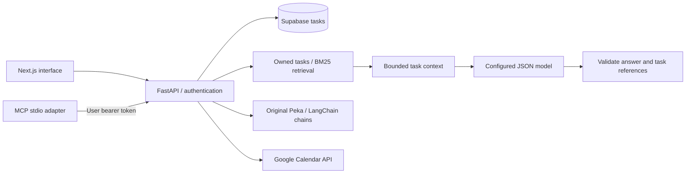

# Architecture and AI, explained

Clash of Plans connects a typed React interface, authenticated API endpoints, database-backed tasks, and language-model assistance. It includes a lightweight task RAG pipeline and a local MCP server alongside the original Peka assistant.

## System overview



## Retrieval-augmented generation

RAG retrieves relevant records at request time, then uses that evidence as context for generation. This implementation uses keyword retrieval over saved tasks, so it needs no embedding service or vector database.

### Request flow

1. A caller sends a question to `POST /api/rag/ask` with the existing application bearer token.
2. The authentication dependency resolves the user. The API does not accept a user ID as an authorization input.
3. `TaskRAGService` loads that user's tasks through the existing service and repository. `retrieve_tasks` filters ownership again before ranking.
4. BM25 ranks task titles, descriptions, and priorities by query-term relevance. Generic questions such as “what should I do next” can fall back to priority ordering. Unrelated queries return no matches.
5. Up to ten records are projected into a small context: task ID, title, description, priority, and estimated duration. Text lengths are bounded, and unrelated database columns are excluded.
6. The service calls the configured JSON-capable provider with JSON output enabled. The system prompt treats task text as untrusted data and asks the model to use only those records.
7. Pydantic validates the answer structure. The service requires task references and rejects references outside the retrieved set. The response includes the answer, suggested action items, and cited source records.
8. If no tasks match, the service returns a helpful no-match response without calling the model.

`POST /api/rag/search` performs steps 1–5 only. It returns retrieved context without generation or a Cohere key.

The database is queried on each request, so edits and deletions need no separate index refresh. This first version scans the user's tasks in memory after the existing owner-filtered database query; database-side search is the next scaling step. Keyword search does not provide synonym understanding or semantic similarity.

Validated source IDs prevent references to records outside the retrieved set. They do not prove that every sentence is supported by those records; answer faithfulness still needs evaluation.

## Model Context Protocol

The adapter in `integrations/mcp/server.py` uses the official MCP Python SDK and the standard stdio transport. A compatible client launches it as a local subprocess and discovers tools through the protocol.

| Tool | Calls | Purpose |
| --- | --- | --- |
| `list_tasks` | `GET /api/todo/` | List the configured user's tasks |
| `search_tasks` | `POST /api/rag/search` | Retrieve relevant task context without generation |
| `ask_tasks` | `POST /api/rag/ask` | Retrieve context and generate a source-linked answer |

All tools are read-only. Their schemas contain queries and limits, never tokens or user IDs. The process reads a user token from `COP_API_TOKEN` and sends it to the existing API, which enforces authentication and user scoping. Expired tokens require a fresh login. The adapter has no direct database credentials or access.

This is a per-user local stdio integration, not a hosted multi-user MCP service. It does not open an HTTP listener or implement a new OAuth authorization server. Remote API URLs must use HTTPS; HTTP is allowed only for loopback development. Redirects are disabled so the adapter does not forward a token to a redirected host. Provider/API errors are returned as sanitized tool failures.

The MCP environment is separate because the official SDK uses newer HTTP dependencies than the original backend. This avoids forcing an unrelated migration of the hackathon's Supabase and LangChain packages.

## Original Peka assistant

The legacy command palette calls `/api/peka/query`. It uses Cohere intent classification and task extraction, then persists created tasks under the authenticated user's ID. Task-analysis and general-response chains use:

```text
ChatPromptTemplate → ChatCohere → PydanticOutputParser
```

The dashboard now uses `/api/rag/ask` through a visible Peka panel and shows retrieved sources. The original command-palette component remains in the repository as a legacy integration. Its unified analyze branch still needs its missing task-context lookup completed; the separate `/api/peka/analyze` route accepts task objects explicitly.

## How the pieces relate

| Component | Contribution |
| --- | --- |
| Cohere | Model inference for the original assistant and new RAG answers |
| LangChain | Original prompt/model/parser composition |
| Task RAG | Query-driven retrieval and generation over authenticated saved tasks |
| MCP | Standard tool discovery and invocation for compatible local AI clients |
| Supabase | Task, user, and onboarding-preference persistence |

RAG determines which task information reaches the model. MCP lets an external AI client access retrieval and answering through discoverable tools. The browser app and MCP adapter share the same API boundary.

## Validation and limits

The automated suite checks retrieval ranking, owner filtering, empty results, bounded context, malformed model output, unknown citations, endpoint authentication, tool argument validation, sanitized errors, and real stdio initialization/discovery. Model responses and API data are mocked for deterministic tests; live Supabase and Cohere calls require configured accounts and are separate verification.

The dashboard’s drag-and-drop calendar persists per account and date on the same browser. Google Calendar is a separate direct integration; automatic bidirectional synchronization is a future step. Database migrations, production authentication/logging hardening, baseline schema provisioning, and broader AI evaluation also remain on the roadmap.

See [setup and examples](rag-mcp.md), [research behind the product](research.md), [Cohere's Chat API](https://docs.cohere.com/reference/chat), and the [official MCP Python SDK](https://github.com/modelcontextprotocol/python-sdk/tree/v1.26.0).


## HEART and weekly reflection

The [HEART mapping](heart.md) covers personal Happiness, Engagement, Adoption, Retention, and Task success signals. Task transitions are recorded by database triggers; focus-session and check-in endpoints use the authenticated owner. `services/heart.py` calculates timezone-aware windows and metrics without a model. Missing ratings and absent comparison periods remain unknown.

The optional weekly reflection receives only computed aggregate evidence. It returns observations with validated evidence IDs and one suggested experiment. It does not invent metric values or replace the calculation layer; factual faithfulness still requires evaluation. Sparse activity returns a getting-started suggestion without inference.

RAG and reflections share [the provider adapter](ai-providers.md). Cohere, OpenAI, and compatible JSON-capable local or hosted endpoints are selected through server environment variables. There is no automatic fallback to another provider.
